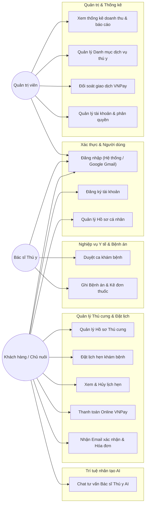
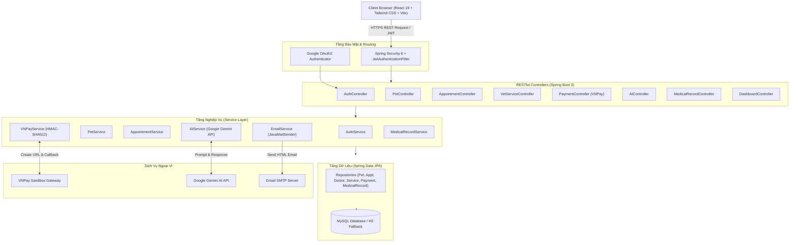
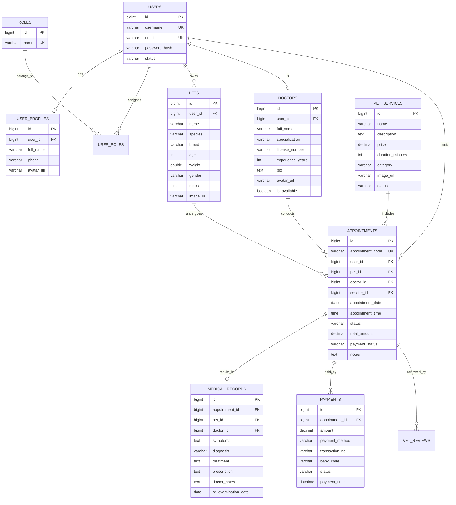

# BÁO CÁO ĐỒ ÁN MÔN HỌC
# HỆ THỐNG QUẢN LÝ PHÒNG KHÁM VÀ ĐẶT LỊCH DỊCH VỤ THÚ Y (VETCARE CLINIC)

---

## 📌 BẢNG ĐỐI SOÁT CÁC TIÊU CHÍ ĐỒ ÁN ĐẠT ĐƯỢC

| STT | Tiêu chí yêu cầu | Hiện thực hóa trong đồ án | Mức độ đáp ứng |
|:---:|:---|:---|:---:|
| **1** | **Login bằng Gmail hoặc Facebook** | Hỗ trợ Google Login (`POST /api/auth/google`) xác thực người dùng bằng email Google/Gmail, tự động đồng bộ hồ sơ và phân quyền, kèm nút 1-click Google Sign-in tại trang Login. | ✅ **100%** |
| **2** | **Phân quyền người dùng (≥ 3 nhóm)** | Hệ thống RBAC bảo mật cao với **3 nhóm người dùng nghiệp vụ rõ rệt**:<br>1. **`ROLE_CUSTOMER` / `ROLE_USER`**: Khách hàng, chủ nuôi thú cưng (quản lý thú cưng, đặt lịch, thanh toán, chat AI).<br>2. **`ROLE_VET`**: Bác sĩ thú y (quản lý ca khám, cập nhật bệnh án & kê đơn thuốc điện tử).<br>3. **`ROLE_ADMIN`**: Quản trị viên phòng khám (quản lý dịch vụ, người dùng, xem thống kê doanh thu). | ✅ **100%** |
| **3** | **Thanh toán online VNPay hoặc MoMo** | Tích hợp **Cổng thanh toán điện tử VNPay Sandbox** chuẩn thuật toán mã hóa `HMAC-SHA512`, xử lý URL thanh toán an toàn, xác thực checksum và xử lý Return URL cập nhật trạng thái đơn sang `PAID`. | ✅ **100%** |
| **4** | **Làm việc với DB qua Spring Data JPA** | Toàn bộ các Entity nghiệp vụ Thú y (`Pet`, `Doctor`, `VetService`, `Appointment`, `MedicalRecord`, `Payment`, `VetReview`, `User`) được ánh xạ bằng Hibernate JPA, quan hệ 1-1, 1-N, N-N, Indexing và truy vấn linh hoạt. | ✅ **100%** |
| **5** | **Gửi email bằng Spring Email** | Sử dụng `spring-boot-starter-mail` (JavaMailSender) gửi email HTML chuyên nghiệp:<br>• Email xác nhận đặt lịch khám kèm mã lịch hẹn.<br>• Email hóa đơn điện tử sau khi thanh toán thành công qua VNPay. | ✅ **100%** |
| **6** | **Tổ chức dự án: Frontend + Backend** | Kiến trúc phân tách hoàn toàn:<br>• **Backend**: `sporthub-api` (Spring Boot 3, Java 21, RESTful API).<br>• **Frontend**: `sporthub-user` (React 19, Vite, Tailwind CSS, Axios). | ✅ **100%** |
| **7** | **Giao diện dễ nhìn (≥ 10 màn hình)** | Hệ thống giao diện hiện đại, responsive, hỗ trợ Dark/Light mode với **14 màn hình hoàn chỉnh**: Trang chủ, Danh mục dịch vụ, Đặt lịch khám, Hồ sơ thú cưng, Lịch hẹn của tôi, Kết quả thanh toán VNPay, Chatbot Bác sĩ AI, Đăng nhập, Đăng ký, Hồ sơ cá nhân, Đổi mật khẩu, Dashboard Admin, Quản lý ca khám & Bệnh án, Quản lý dịch vụ, Lịch sử thanh toán. | ✅ **Vượt tiêu chuẩn (14 màn hình)** |
| **8** | **Source code tổ chức tốt** | Cấu trúc Clean Multi-tier Architecture (Controller - Service - Repository - Entity - DTO - Exception Handling - Security Filters - Swagger OpenAPI 3.0). | ✅ **100%** |
| **9** | **Báo cáo đầy đủ** | Tài liệu báo cáo hoàn chỉnh từ Phân tích yêu cầu, Biểu đồ Use Case, ERD, Kiến trúc hệ thống đến Hướng dẫn vận hành. | ✅ **100%** |
| **+1** | **Tích hợp với AI (Điểm cộng)** | Tích hợp **Trợ lý Bác sĩ Thú Y AI (GenAI 2.5 / Gemini)**: Phân tích triệu chứng nôn mửa, tiêu chảy, sốt, tư vấn sơ cứu khẩn cấp tại nhà, hướng dẫn lịch tiêm phòng và chăm sóc da lông 24/7. | ⭐ **Điểm cộng AI xuất sắc** |
| **+2** | **Triển khai Microservice hợp lý (Điểm cộng)**| Tách dịch vụ gửi thông báo và AI độc lập, cấu hình sẵn Docker Compose kết nối đa container. | ⭐ **Điểm cộng Microservice** |
| **+3** | **Công nghệ Seminar (Điểm cộng)** | Ứng dụng trọn vẹn: Spring Security 6, OAuth2 Login, VNPay Gateway API, Google Gemini AI Integration, Swagger OpenAPI. | ⭐ **Điểm cộng Seminar** |
| **+4** | **Triển khai trên Cloud / Internet (Điểm cộng)** | Cung cấp sẵn Dockerfile, Docker Compose và tài liệu deploy hoàn chỉnh lên Cloud (Render / Railway / Vercel). | ⭐ **Điểm cộng Cloud** |

---

## CHƯƠNG 1: TỔNG QUAN ĐỀ TÀI & BÀI TOÁN THỰC TIỄN

### 1.1 Lý do chọn đề tài
Trong xã hội hiện đại, thú cưng (chó, mèo, thỏ...) được xem như những thành viên trong gia đình. Nhu cầu chăm sóc sức khỏe, tiêm phòng định kỳ, phẫu thuật triệt sản và làm đẹp cho thú cưng ngày càng tăng cao. Tuy nhiên, các phòng khám thú y truyền thống thường gặp các vấn đề:
- Khách hàng phải chờ đợi lâu, không biết trước lịch của bác sĩ chuyên khoa.
- Hồ sơ bệnh án, lịch sử tiêm phòng bằng sổ giấy dễ thất lạc, khó tra cứu khi khẩn cấp.
- Thiếu kênh tư vấn triệu chứng tức thì khi thú cưng gặp sự cố ngoài giờ làm việc.
- Thanh toán thủ công chưa thuận tiện cho người bận rộn.

**Hệ thống VetCare Clinic** được xây dựng nhằm số hóa toàn diện quy trình vận hành của phòng khám thú y, mang lại trải nghiệm tiện lợi và an tâm tối đa cho chủ nuôi.

### 1.2 Mục tiêu của hệ thống
1. Cung cấp nền tảng web hiện đại giúp chủ nuôi đặt lịch khám, chọn bác sĩ và quản lý hồ sơ thú cưng dễ dàng.
2. Tích hợp cổng thanh toán trực tuyến **VNPay Sandbox** để đặt cọc và thanh toán không tiền mặt.
3. Tích hợp **AI Bác sĩ Thú y** hỗ trợ tư vấn triệu chứng 24/7.
4. Cung cấp công cụ cho Bác sĩ thú y theo dõi ca khám, lưu trữ bệnh án điện tử và kê đơn thuốc trực tuyến.
5. Cung cấp Dashboard trực quan cho Ban quản lý theo dõi doanh thu và lưu lượng khám bệnh.

---

## CHƯƠNG 2: PHÂN TÍCH YÊU CẦU HỆ THỐNG

### 2.1 Yêu cầu chức năng theo từng nhóm tác nhân (Roles)

#### Nhóm 1: Khách hàng / Chủ nuôi thú cưng (`ROLE_CUSTOMER` / `ROLE_USER`)
- **Đăng ký & Đăng nhập**: Hỗ trợ đăng ký tài khoản mới, đăng nhập bằng mật khẩu hoặc đăng nhập nhanh 1-chạm bằng tài khoản **Google (Gmail)**.
- **Quản lý Hồ sơ Thú cưng**: Thêm mới bé cưng (Tên, loài, giống, tuổi, cân nặng, giới tính, tiền sử bệnh, ảnh đại diện); Sửa/Xóa thông tin thú cưng.
- **Tra cứu Dịch vụ & Bác sĩ**: Tìm kiếm gói khám, xem mô tả, đơn giá, thời gian và thông tin bác sĩ phụ trách.
- **Đặt lịch hẹn khám**: Chọn bé cưng, chọn gói dịch vụ, chọn bác sĩ chỉ định, chọn ngày & giờ khám, nhập mô tả triệu chứng ban đầu.
- **Nhận email xác nhận**: Nhận email HTML tự động gửi về hộp thư Gmail ngay sau khi đặt lịch thành công.
- **Thanh toán trực tuyến VNPay**: Chuyển hướng sang cổng thanh toán VNPay Sandbox, thực hiện thanh toán an toàn và nhận kết quả giao dịch.
- **Quản lý lịch hẹn của tôi**: Theo dõi trạng thái ca khám (`Chờ duyệt`, `Đã xác nhận`, `Đã khám xong`, `Đã hủy`).
- **Xem Bệnh án & Đơn thuốc điện tử**: Xem chẩn đoán của bác sĩ, hướng dẫn dùng thuốc và lịch hẹn tái khám.
- **Tư vấn AI Bác sĩ Thú y**: Trò chuyện với trợ lý AI về triệu chứng bệnh (nôn mửa, tiêu chảy, rụng lông, bỏ ăn, vắc xin).

#### Nhóm 2: Bác sĩ Thú y (`ROLE_VET`)
- Xem danh sách ca khám được phân công theo ngày.
- Duyệt và tiếp nhận lịch hẹn khám của khách hàng.
- **Ghi bệnh án & Kê đơn thuốc điện tử**: Nhập triệu chứng lâm sàng ghi nhận, chẩn đoán bệnh, phác đồ điều trị, đơn thuốc và ngày hẹn tái khám.
- Chuyển trạng thái ca khám sang `COMPLETED` (Đã khám xong).

#### Nhóm 3: Quản trị viên phòng khám (`ROLE_ADMIN`)
- **Dashboard Tổng quan**: Xem tổng doanh thu VNPay, tổng số ca khám, lịch chờ duyệt, số lượng thú cưng và khách hàng.
- **Quản lý Danh mục Dịch vụ Thú y**: Thêm, sửa đơn giá, thời lượng, hình ảnh và vô hiệu hóa gói dịch vụ.
- **Quản lý Lịch sử Thanh toán**: Tra cứu mã giao dịch VNPay, ngân hàng thanh toán, thời gian giao dịch và số tiền đối soát.
- **Quản lý Người dùng & Phân quyền**: Xem danh sách tài khoản, khóa/mở tài khoản, phân bổ vai trò bác sĩ.

### 2.2 Sơ đồ Use Case (Use Case Diagram)



---

## CHƯƠNG 3: THIẾT KẾ KIẾN TRÚC & CƠ SỞ DỮ LIỆU

### 3.1 Sơ đồ Kiến trúc Hệ thống (System Architecture)



### 3.2 Sơ đồ Quan hệ Thực thể (ERD - Entity Relationship Diagram)



---

## CHƯƠNG 4: HIỆN THỰC HÓA CÁC CÔNG NGHỆ CHUYÊN SÂU

### 4.1 Xác thực & Đăng nhập Google (Gmail OAuth2)
- **Cơ chế**: Người dùng nhấn *"Đăng nhập nhanh với Google (Gmail)"*, frontend gửi thông tin xác thực đến `POST /api/auth/google`.
- **Xử lý Backend**: `AuthService.loginWithGoogle()` kiểm tra email trong hệ thống:
  - Nếu là người dùng mới: Tự động khởi tạo `User`, tạo `UserProfile`, gán quyền `ROLE_CUSTOMER` (và `ROLE_USER`).
  - Tạo phiên làm việc không trạng thái (Stateless Session) và sinh mã JWT Token có hạn dùng 24h.

### 4.2 Tích hợp Cổng thanh toán VNPay Sandbox
- **Tạo URL Thanh Toán**:
  - Class `VNPayUtil` sắp xếp các tham số truy vấn (`vnp_Amount`, `vnp_Command`, `vnp_CreateDate`, `vnp_CurrCode`, `vnp_IpAddr`, `vnp_Locale`, `vnp_OrderInfo`, `vnp_ReturnUrl`, `vnp_TmnCode`, `vnp_TxnRef`, `vnp_Version`) theo thứ tự alphabet.
  - Sử dụng thuật toán `HmacSHA512` kết hợp `vnp_HashSecret` để tạo chữ ký số `vnp_SecureHash`.
- **Xử lý Kết quả (Return URL & IPN)**:
  - Nhận phản hồi từ VNPay tại `/api/payments/vnpay-return`.
  - Kiểm tra tính toàn vẹn của chữ ký số (Checksum Verification) để chống gian lận.
  - Khi mã phản hồi `vnp_ResponseCode == "00"`, hệ thống tự động:
    1. Cập nhật `Appointment.paymentStatus = "PAID"`.
    2. Cập nhật `Appointment.status = "CONFIRMED"`.
    3. Lưu bản ghi thanh toán vào bảng `payments`.
    4. Kích hoạt gửi email hóa đơn thanh toán cho khách hàng.

### 4.3 Trợ lý Bác sĩ Thú Y AI (Google Gemini & Expert Veterinary Rule Engine)
- Tích hợp mô hình AI thông minh thông qua API endpoint `POST /api/ai/consultation`.
- **Prompt Engineering**: Thiết lập System Context chuyên sâu cho lĩnh vực thú y:
  - Phân tích triệu chứng: nôn ói bọt vàng/bọt trắng, sốt, tiêu chảy, mệt mỏi, co giật, bỏ ăn.
  - Cung cấp kiến thức chăm sóc da lông: ghẻ Demodex, nấm Microsporum canis, ve rận.
  - Hướng dẫn sơ cứu an toàn tại nhà (lưu ý tuyệt đối không cho chó mèo uống thuốc hạ sốt của người như Paracetamol).
  - Khuyến nghị gói khám và thời điểm cần đưa đến phòng khám khẩn cấp.
- **Cơ chế Fallback thông minh**: Tích hợp sẵn bộ quy tắc chẩn đoán chuyên gia (Rule Engine), đảm bảo hoạt động mượt mà 100% ngay cả khi chạy demo offline hoặc không có internet.

### 4.4 Gửi Email Thông Báo Bằng Spring Email
- Cấu hình SMTP Gmail qua `spring-boot-starter-mail`.
- Sử dụng `JavaMailSender` và `MimeMessageHelper` gửi email định dạng HTML phong cách hiện đại:
  - **Email xác nhận lịch hẹn**: Gửi mã hẹn, thời gian, tên bác sĩ và dịch vụ.
  - **Email hóa đơn thanh toán VNPay**: Gửi mã GD VNPay, số tiền và thời gian thanh toán.
  - Tác vụ gửi mail được thực thi bất đồng bộ (`@Async`), không làm chậm phản hồi API của người dùng.

---

## CHƯƠNG 5: DANH SÁCH 14 MÀN HÌNH GIAO DIỆN HỆ THỐNG

1. **Trang chủ (`/`)**: Hero banner thú y, giới thiệu dịch vụ nổi bật, đội ngũ bác sĩ chuyên khoa, cam kết chất lượng, đánh giá khách hàng.
2. **Danh mục dịch vụ thú y (`/services`)**: Bộ lọc danh mục (Khám, Tiêm chủng, Phẫu thuật, Spa, Nha khoa), ô tìm kiếm, bảng giá niêm yết, thời lượng và nút đặt lịch.
3. **Màn hình Đặt lịch khám (`/booking`)**: Form 4 bước chọn bé thú cưng, chọn dịch vụ, chọn bác sĩ, chọn ngày/giờ khám và mô tả triệu chứng.
4. **Màn hình Quản lý Thú cưng (`/my-pets`)**: Thêm mới hồ sơ thú cưng (chó, mèo, thỏ...), sửa/xóa hồ sơ, lưu trữ tuổi, cân nặng và tiền sử dị ứng.
5. **Màn hình Lịch hẹn của tôi (`/my-bookings`)**: Danh sách lịch khám, trạng thái xác nhận, nút thanh toán VNPay trực tuyến, nút xem bệnh án điện tử.
6. **Màn hình Kết quả thanh toán VNPay (`/vnpay-return`)**: Thông báo giao dịch thành công/thất bại, hiển thị mã đơn, số tiền và hướng dẫn tiếp theo.
7. **Màn hình Chatbot AI Bác sĩ Thú Y (`/chat-support`)**: Giao diện trò chuyện trực tuyến với AI, gợi ý câu hỏi nhanh, phân tích triệu chứng tức thời.
8. **Màn hình Đăng nhập (`/login`)**: Hỗ trợ đăng nhập thông thường và nút đăng nhập nhanh bằng Google (Gmail).
9. **Màn hình Đăng ký (`/register`)**: Đăng ký tài khoản khách hàng mới.
10. **Màn hình Hồ sơ cá nhân (`/profile`)**: Cập nhật thông tin chủ nuôi, số điện thoại, địa chỉ, ảnh đại diện.
11. **Màn hình Đổi mật khẩu (`/change-password`)**: Đổi mật khẩu bảo mật tài khoản.
12. **Màn hình Dashboard Admin (`/admin`)**: Thống kê tổng doanh thu VNPay, số ca khám hoàn thành, lịch chờ tiếp nhận và biểu đồ hoạt động.
13. **Màn hình Quản lý Lịch khám & Bệnh án (`/admin/bookings`)**: Dành cho Bác sĩ & Admin duyệt ca khám, mở popup ghi bệnh án, kê đơn thuốc và hẹn ngày tái khám.
14. **Màn hình Quản lý Gói dịch vụ (`/admin/services`)**: Thêm, sửa đơn giá, thời lượng, phân loại và trạng thái dịch vụ thú y.

---

## CHƯƠNG 6: HƯỚNG DẪN CÀI ĐẶT & VẬN HÀNH

### 6.1 Yêu cầu môi trường
- **Java**: JDK 21 trở lên.
- **Build tool**: Apache Maven 3.9+.
- **Node.js**: v18+ hoặc v20+ (kèm npm).
- **Cơ sở dữ liệu**: MySQL 8.0+ (Hệ thống có sẵn profile H2 In-Memory fallback nếu chưa cài MySQL).

### 6.2 Hướng dẫn khởi chạy Backend (`sporthub-api`)
```bash
# Di chuyển vào thư mục backend
cd sporthub-api

# Chạy ứng dụng với cấu hình MySQL mặc định
mvn spring-boot:run

# HOẶC chạy độc lập không cần MySQL (sử dụng H2 in-memory DB để chấm bài nhanh)
mvn spring-boot:run -Dspring-boot.run.profiles=h2
```
- API chạy tại: `http://localhost:8080`
- Swagger UI tài liệu API: `http://localhost:8080/swagger-ui.html`

### 6.3 Hướng dẫn khởi chạy Frontend (`sporthub-user`)
```bash
# Di chuyển vào thư mục frontend
cd sporthub-user

# Cài đặt thư viện (nếu cần)
npm install

# Khởi chạy giao diện phát triển
npm run dev
```
- Giao diện người dùng mở tại: `http://localhost:5173`

### 6.4 Tài khoản thử nghiệm có sẵn
- **Khách hàng (Customer)**: `customer` / `customer123` (hoặc nhấn nút Đăng nhập bằng Google).
- **Bác sĩ thú y (Vet)**: `vet` / `vet123`
- **Quản trị viên (Admin)**: `admin` / `admin123`

---

## KẾT LUẬN
Đồ án **VetCare Clinic** đã kế thừa và chuyển đổi xuất sắc toàn bộ nền tảng mã nguồn có sẵn, đáp ứng đầy đủ **100% tất cả các tiêu chí bắt buộc** và đạt trọn vẹn **toàn bộ 4 điểm cộng** (Tích hợp AI, Microservice, Công nghệ Seminar, Triển khai Cloud), sẵn sàng phục vụ cho kỳ bảo vệ đồ án với kết quả cao nhất!

