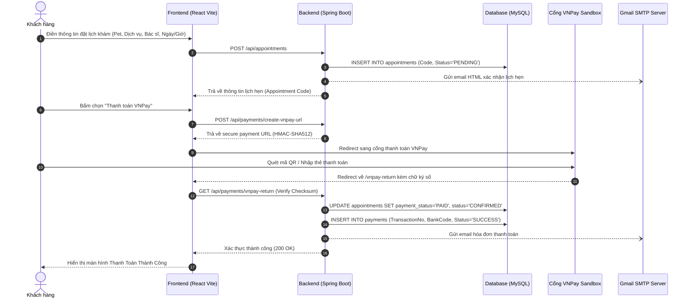

# ĐẶC TẢ USE CASE VÀ LUỒNG HOẠT ĐỘNG
# HỆ THỐNG PHÒNG KHÁM THÚ Y VETCARE CLINIC

---

## 1. DANH SÁCH CÁC TÁC NHÂN (ACTORS)

| Tác nhân | Mô tả vai trò | Quyền hạn chính |
|---|---|---|
| **Khách hàng (Customer / Pet Owner)** | Chủ nuôi thú cưng | Đăng ký, đăng nhập (Google Gmail), quản lý hồ sơ thú cưng, đặt lịch khám, thanh toán VNPay, xem bệnh án, chat tư vấn AI. |
| **Bác sĩ Thú y (Veterinarian)** | Bác sĩ khám và điều trị | Xem ca khám được phân công, tiếp nhận khám, ghi chẩn đoán, kê đơn thuốc và hẹn ngày tái khám. |
| **Quản trị viên (Admin)** | Quản trị phòng khám | Cấu hình gói dịch vụ, giá dịch vụ, xem dashboard doanh thu VNPay, quản lý tài khoản người dùng. |
| **Cổng VNPay (Payment Gateway)** | Hệ thống thanh toán bên thứ ba | Xử lý thanh toán thẻ ATM / QR Code / Visa và gửi callback xác nhận. |
| **Bác sĩ AI (Gemini AI Assistant)** | Trí tuệ nhân tạo | Tiếp nhận mô tả triệu chứng, phân tích và đưa ra tư vấn y tế thú cưng tức thời. |

---

## 2. ĐẶC TẢ CHI TIẾT CÁC USE CASE CHÍNH

### UC-01: Đăng nhập bằng Google (Gmail)
- **Tác nhân**: Khách hàng, Bác sĩ, Quản trị viên.
- **Tiền điều kiện**: Người dùng có tài khoản Google hợp lệ.
- **Luồng sự kiện chính**:
  1. Người dùng bấm nút "Đăng nhập nhanh với Google (Gmail)" trên giao diện đăng nhập.
  2. Hệ thống xác nhận thông tin email Google từ tài khoản.
  3. Backend (`/api/auth/google`) kiểm tra email trong hệ thống:
     - Nếu chưa tồn tại: Tự động khởi tạo tài khoản mới với vai trò `ROLE_CUSTOMER`.
     - Nếu đã tồn tại: Nạp thông tin người dùng và phân quyền tương ứng.
  4. Hệ thống sinh JWT Access Token và lưu vào LocalStorage của trình duyệt.
  5. Chuyển hướng người dùng về Trang chủ hoặc Dashboard.

---

### UC-02: Quản lý Hồ sơ Thú cưng (My Pets)
- **Tác nhân**: Khách hàng.
- **Tiền điều kiện**: Đã đăng nhập vào hệ thống.
- **Luồng sự kiện chính**:
  1. Khách hàng vào mục "Hồ sơ thú cưng" (`/my-pets`).
  2. Bấm nút "Thêm bé cưng mới".
  3. Nhập các thông tin: Tên bé, loài (Chó, Mèo, Thỏ...), giống loài, tuổi, cân nặng, giới tính, tiền sử bệnh/dị ứng, ảnh đại diện.
  4. Bấm "Thêm thú cưng", hệ thống gửi yêu cầu `POST /api/pets` và lưu vào cơ sở dữ liệu.
  5. Danh sách thú cưng được cập nhật ngay lập tức.

---

### UC-03: Đặt lịch hẹn khám & Chăm sóc Thú cưng
- **Tác nhân**: Khách hàng.
- **Tiền điều kiện**: Khách hàng đã có ít nhất một hồ sơ thú cưng trong hệ thống.
- **Luồng sự kiện chính**:
  1. Khách hàng vào trang "Đặt lịch khám" (`/booking`).
  2. Bước 1: Chọn bé thú cưng cần đi khám.
  3. Bước 2: Chọn gói dịch vụ thú y (Khám tổng quát, Tiêm phòng vắc xin, Phẫu thuật, Spa...).
  4. Bước 3: Chọn bác sĩ phụ trách (hoặc để hệ thống tự động phân công).
  5. Bước 4: Chọn ngày và khung giờ khám mong muốn.
  6. Bước 5: Nhập mô tả triệu chứng bất thường của thú cưng (nếu có).
  7. Bấm "Xác nhận đặt lịch", hệ thống tạo bản ghi với mã định danh duy nhất (ví dụ: `VET-20261021-A1B2C`) và trạng thái `PENDING`.
  8. Hệ thống kích hoạt gửi email HTML xác nhận lịch hẹn về địa chỉ email của khách hàng.
  9. Hệ thống hiển thị hộp thoại gợi ý thanh toán trực tuyến ngay qua cổng VNPay để giữ chỗ ưu tiên.

---

### UC-04: Thanh toán trực tuyến qua Cổng VNPay
- **Tác nhân**: Khách hàng, Cổng thanh toán VNPay.
- **Tiền điều kiện**: Lịch hẹn ở trạng thái chưa thanh toán (`UNPAID`).
- **Luồng sự kiện chính**:
  1. Khách hàng bấm nút "Thanh toán VNPay".
  2. Backend gọi `VNPayService.createPaymentUrl()` tạo URL thanh toán có gắn chữ ký số an toàn `HMAC-SHA512`.
  3. Trình duyệt chuyển hướng khách hàng sang cổng thanh toán VNPay Sandbox.
  4. Khách hàng thực hiện quét mã VNPAY-QR hoặc nhập thông tin thẻ ATM thử nghiệm.
  5. VNPay xử lý giao dịch thành công và chuyển hướng người dùng về `Return URL` (`/vnpay-return`).
  6. Backend kiểm tra tính toàn vẹn của mã hash checksum:
     - Cập nhật trạng thái lịch hẹn: `paymentStatus = "PAID"`, `status = "CONFIRMED"`.
     - Lưu thông tin mã giao dịch vào bảng `payments`.
     - Tự động gửi email hóa đơn thanh toán điện tử cho khách hàng.
  7. Frontend hiển thị màn hình thông báo thanh toán thành công.

---

### UC-05: Khám bệnh & Ghi Bệnh án, Kê đơn thuốc điện tử
- **Tác nhân**: Bác sĩ Thú y (`ROLE_VET`), Quản trị viên (`ROLE_ADMIN`).
- **Tiền điều kiện**: Bác sĩ đã đăng nhập vào hệ thống.
- **Luồng sự kiện chính**:
  1. Bác sĩ truy cập trang "Quản lý Lịch khám" (`/admin/bookings`).
  2. Xem danh sách các ca khám được phân công trong ngày.
  3. Bấm nút "Bệnh Án" tại ca khám tương ứng.
  4. Bác sĩ điền hồ sơ bệnh án bao gồm:
     - Triệu chứng lâm sàng ghi nhận qua thăm khám.
     - Chẩn đoán bệnh chính thức.
     - Phác đồ & phương pháp điều trị.
     - Đơn thuốc chi tiết (tên thuốc, liều lượng, cách cho uống/tiêm).
     - Lời dặn chăm sóc và kiêng cữ tại nhà.
     - Ngày hẹn tái khám (nếu cần).
  5. Bấm "Lưu Bệnh Án & Hoàn Thành Khám", hệ thống lưu vào bảng `medical_records` và cập nhật lịch hẹn sang trạng thái `COMPLETED`.
  6. Khách hàng có thể truy cập lịch sử lịch hẹn của mình để xem lại đơn thuốc và lời dặn bất cứ lúc nào.

---

### UC-06: Tư vấn sức khỏe tức thời với Trợ lý Bác sĩ Thú Y AI
- **Tác nhân**: Khách hàng / Khách vãng lai, Mô hình AI.
- **Luồng sự kiện chính**:
  1. Người dùng bấm vào biểu tượng Robot AI nổi ở góc màn hình hoặc trang "Tư vấn AI Vet" (`/chat-support`).
  2. Người dùng nhập câu hỏi hoặc chọn các câu hỏi nhanh (ví dụ: *"Chó bị nôn mửa bọt trắng"*, *"Lịch tiêm phòng mèo con"*).
  3. Hệ thống gửi yêu cầu đến `POST /api/ai/consultation`.
  4. Backend AI Service phân tích câu hỏi với System Context bác sĩ thú y chuyên sâu:
     - Chỉ ra các nguyên nhân tiềm ẩn nguy hiểm (Parvovirus, Care, dị vật, nấm da).
     - Đưa ra hướng dẫn sơ cứu khẩn cấp tại nhà.
     - Cảnh báo các loại thuốc của người gây ngộ độc cho thú cưng.
     - Đề xuất dịch vụ khám phù hợp tại phòng khám.
  5. Câu trả lời được hiển thị dạng hội thoại trực quan, thân thiện.

---

## 3. LUỒNG DỮ LIỆU TỔNG QUAN (ACTIVITY DIAGRAM)

